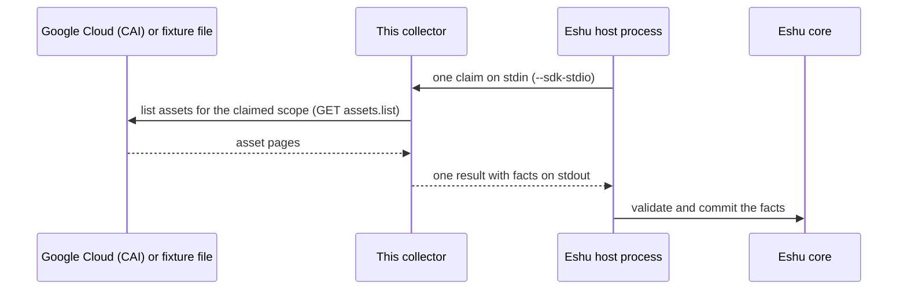

# eshu-collector-gcp-cloud

**Status: pre-release.** Eshu core still owns this data in production.
This repo has no authority to publish facts on its own yet.

This collector reads Google Cloud asset data and hands Eshu evidence
about what exists in a Google Cloud scope, how those resources
relate, and who can access them, so you can answer which Google Cloud
resources Eshu has seen and how they connect.

A *fact* is one small, typed piece of evidence.
A *claim* is one bounded request to collect one scope.
The *host* is the Eshu process that starts this collector, sends it a
claim, and stores the result.
CAI below means Cloud Asset Inventory, Google Cloud's asset listing
service.
This collector only collects and returns evidence. It does not store anything itself.

## What it collects

The table below is generated from `spec.emittedFacts` in
[manifest.yaml](manifest.yaml).
That file declares 10 fact kinds with `reported` confidence (the
source reported it; Eshu did not measure it directly).
`gcp_cloud_resource` is at schema `1.1.0`; the other nine are at
`1.0.0`.

| Fact kind | Plain meaning |
|---|---|
| `gcp_cloud_resource` | One Google Cloud resource seen in the scope |
| `gcp_cloud_relationship` | One link between two Google Cloud resources |
| `gcp_tag_observation` | Tags or labels seen on one resource |
| `gcp_iam_policy_observation` | An IAM policy (who can do what) seen on a resource |
| `gcp_dns_record` | One DNS record seen for a resource |
| `gcp_image_reference` | A container or machine image a resource points at |
| `gcp_iam_principal` | One IAM identity (a who) seen in the scope |
| `gcp_iam_trust_policy` | Who is allowed to act as one IAM identity |
| `gcp_iam_permission_policy` | What one IAM identity is allowed to do |
| `gcp_collection_warning` | Part of the scope could not be read fully |

## How it fits in



In text: Google Cloud (or a fixture file) -> this collector -> Eshu host process -> Eshu core. Each host request gets exactly one result document back; there is no multi-page continuation in this version.

## When to use it

Use it when Eshu needs evidence about Google Cloud resources under
one organization, folder, or project, including their relationships,
tags, DNS records, image references, and IAM policies and identities.

## When not to use it

- Do not use it as a live Google Cloud browser or reporting tool.
  It returns facts to the Eshu host; it has no user interface.
- Do not mix credentials in one activation.
  Scopes that name different `credential_ref` values fail closed.
- Do not use it for other clouds or for Google Cloud data-plane
  contents (object data, secrets, or record payloads).

## How Eshu runs it

The host runs one claim per process invocation.
It starts `./collector --sdk-stdio`, writes one
`collector-sdk/v1alpha1` request to stdin, and reads one result from
stdout.
The host owns admission, identity, storage, and recovery.
This binary never commits facts itself.

```bash
go run ./cmd/collector --sdk-stdio < request.json > result.json
```

Without `--sdk-stdio`, the binary collects one fixture file claim.
Fixture and unit tests make no live Google Cloud call.

```bash
go run ./cmd/collector --input testdata/complete.json
```

The binary is also its own installer.
`seed` writes the collector binary and [manifest.yaml](manifest.yaml)
into a component directory and can stamp the deployed image digest
into the seeded manifest:

```bash
collector seed --dest DIR --image-ref ghcr.io/eshu-hq/eshu-collector-gcp-cloud@sha256:<digest>
```

Without `--image-ref`, `COLLECTOR_IMAGE_REF` supplies the reference.
[manifest.yaml](manifest.yaml) pins the Linux amd64 image for
version `0.1.4` by digest:
`ghcr.io/eshu-hq/eshu-collector-gcp-cloud@sha256:06cc0b5747226adea1d753df61b097930bb8220e17c838346e6a1b2bec840a38`.
The image entrypoint is `/usr/local/bin/collector --sdk-stdio`
(see [Dockerfile](Dockerfile)).

## Configuration

There is no `config.example.*` file in this repo.
The host request `config` object is the configuration.
A request with `source.input` takes the fixture-file path; a request
without it must carry the live fields below.

| Name | Required | Default | Meaning |
|---|---|---|---|
| `collector_instance_id` | Yes for live | None | Instance that owns scope policy |
| `scopes` | Yes for live, at least one | None | Bounded Google Cloud scopes this instance may scan |
| `scopes[].parent_scope_kind` | Yes | None | `organization`, `folder`, or `project` |
| `scopes[].parent_scope_id` | Yes | None | Organization number, folder number, or project ID |
| `scopes[].credential_ref` | Yes | None | Name of the read-only credential; never a secret value |
| `scopes[].asset_type_family` | No | `mixed` | Asset family shard for the scope |
| `scopes[].content_family` | No | `resource` | CAI content family shard |
| `scopes[].location_bucket` | No | `global` | Location shard |
| `source.input` | No | Flag default `testdata/complete.json` | Fixture file to read instead of Google Cloud |
| `source.sourceURI` | No | `https://example.invalid/source/gcp-cloud` | Credential-free source address recorded on facts |
| `source.redactionKeyEnv` | Yes for live | Must be `ESHU_GCP_REDACTION_KEY` | Name of the env var holding redaction key material |
| `freshness.previousDigest` | No | Empty | Prior digest; an unchanged scan returns a fact-free `unchanged` result |
| `limits.maxRecordsPerClaim` | No | `5000` | Maximum facts in one claim |
| `limits.maxPayloadBytes` | No | `65536` | Maximum bytes in one fact payload |
| `limits.claimTimeoutSeconds` | No | `300` | Maximum wall-clock seconds for one claim |
| `limits.maxPageBytes` | No | `4128768` (4 MiB minus 64 KiB headroom) | Maximum bytes in the one result document |

Local flags mirror these: `--input`, `--source-uri`,
`--parent-scope-kind`, `--parent-scope-id`, `--previous-digest`,
`--max-records`, `--max-payload-bytes`, `--claim-timeout-seconds`,
and `--max-page-bytes`.
Zero selects the default; negative values fail.

## Credentials and least privilege

Config names a credential with `credential_ref`; it never holds a
secret value.
Live reads use Application Default Credentials (ADC, Google Cloud's
standard credential lookup) and only GET `assets.list` calls, plus
opt-in read-only tag listing calls when a scope enables them in code.
The OAuth scope requested in code is
`https://www.googleapis.com/auth/cloud-platform`, which
`assets.list` accepts.
The collector itself only reads; it never calls a write API.
This repo does not name a specific IAM role, so grant the named
credential only the read access the claimed scope needs and stop
there.
Redaction key material comes only from the `ESHU_GCP_REDACTION_KEY`
environment variable; config names that variable, never its value.
One claim uses one ADC identity: scopes naming different
`credential_ref` values return a terminal result.

## Claim budget and operator signals

One claim is bounded by the limits above (defaults: 5,000 records,
65,536 payload bytes per fact, 300 seconds, 4,128,768 result bytes).
One input page document is capped at 32 MiB.
A result over the page budget fails the claim as terminal with class
`page-budget-exceeded`; it is never split into pages.
A scope that cannot be scanned fails closed with a terminal result;
no claim reports complete for a scope it did not read.
Each run writes one health line to stderr with liveness, last
success time and digest, failure count and reason, retry depth, and
the effective limits.
Health text carries no credentials or payloads.
The manifest declares the metric prefix `eshu_dp_gcp_cloud_`; the
stderr health line is the operator signal proven by the code here.

## Eshu dependencies

| Dependency | Version or contract | Source |
|---|---|---|
| `github.com/eshu-hq/eshu-sdk/collector` | `v0.2.0-rc.2` | `go.mod` |
| `github.com/eshu-hq/eshu-sdk/factschema` | `v0.1.0-rc.12` | `go.mod` |
| Host protocol | `collector-sdk/v1alpha1`, `process` adapter | [manifest.yaml](manifest.yaml) |
| Eshu core compatibility | `>=0.0.5 <0.2.0` | [manifest.yaml](manifest.yaml) |
| Producer identity | `collector-gcp-cloud`, version `0.1.4` | [manifest.yaml](manifest.yaml) |

## What this never does

- It never writes to the Eshu graph, Postgres, or any queue.
  The host validates the result and commits the facts.
- It never performs a Google Cloud write; live transport is GET-only.
- It never stores a secret value in config, facts, logs, or labels.
  Credentials and redaction material resolve by name from the
  process environment.
- It never scans a scope that config did not list.

## Build, test, and release

```bash
make ci
```

`make ci` runs `make lint`, `make test`, and `make race` (see
[Makefile](Makefile)): vet, lint and format checks, module drift,
the 500-line file cap, the full test suite, and the race suite.
See [CONTRIBUTING.md](CONTRIBUTING.md) for CI lanes and the coverage
floor, which may only rise.
Releasing is maintainer-run and digest-by-digest; nothing here
deploys:

1. Tag the protected `main` head with exactly `v` plus the
   `metadata.version` in [manifest.yaml](manifest.yaml).
   Any other tag fails before anything builds or pushes.
2. Push the tag; the release workflow builds, signs, and publishes
   the image with SBOM and provenance attestations and prints the
   digest-pinned reference in the job summary.
3. Record that digest in the manifest with `scripts/pin-digest.sh`,
   then seed activations from the published digest as shown above.

## Docs and related repos

- [manifest.yaml](manifest.yaml) — component identity, facts, and image pin
- [eshu](https://github.com/eshu-hq/eshu) — Eshu core
- [eshu-sdk](https://github.com/eshu-hq/eshu-sdk) — collector and fact-schema contracts
- [eshu-deploy](https://github.com/eshu-hq/eshu-deploy) — deployment charts and activations

## Contributing, security, and license

See [CONTRIBUTING.md](CONTRIBUTING.md) before opening a change.
There is no `SECURITY.md` in this repo.
Licensed under MIT; see [LICENSE](LICENSE).
