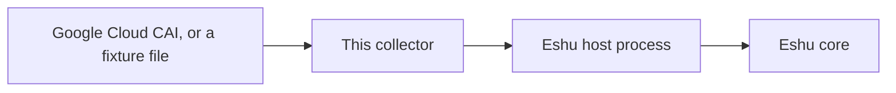
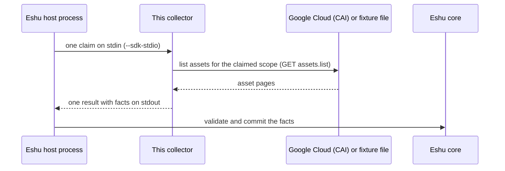
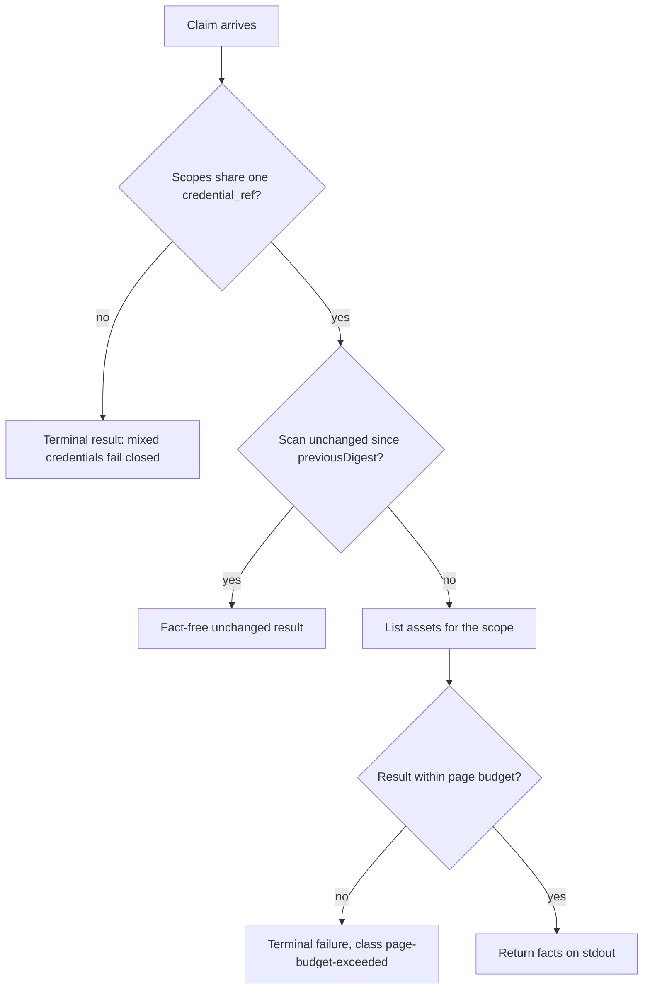

# Diagrams

Every diagram for this collector lives on this page, each with a
caption and a plain-text version so nothing depends on rendering.
Other pages link here instead of copying a diagram. (The repo
[README](../../README.md) keeps the first one as its overview.)

## 1. Where it sits

*Caption: source data flows into this collector, then to the Eshu
host process, then to Eshu core. The collector itself stores
nothing.*

Text version: Google Cloud (or a fixture file) -> this collector ->
Eshu host process -> Eshu core.

## 2. One claim, start to finish

*Caption: one process invocation serves exactly one claim. The host
writes the request, the collector reads the claimed scope, facts
come back on stdout, and the host validates and commits.*

Text version: the host writes one `collector-sdk/v1alpha1` request to
stdin, the collector reads the claimed scope and builds facts,
then writes one result to stdout. Each host request gets exactly
one result document back; there's no multi-page continuation in
this version.

## 3. When something goes wrong

*Caption: the failure paths. Bounded, fail-closed outcomes are
preferred over late, oversized, or silently incomplete evidence;
partial reads say so instead of pretending.*

Text version: scopes naming different `credential_ref` values return a
terminal result, because one claim uses one ADC identity. A scan
that matches `freshness.previousDigest` returns a fact-free
`unchanged` result. A result over the page budget fails the claim
as terminal with class `page-budget-exceeded`; it's never split
into pages. A scope that can't be scanned fails closed with a
terminal result; no claim reports complete for a scope it didn't
read.
